<!-- Hero Card -->

  

<!-- Three Linked Tiles in a Row (Each at width 32.5%) -->

  

<!-- Monthly Contributions Bar Chart & Stats -->

  

<!-- One Card Per Featured Repo (Each at width 32.5%) -->

  
  
  

  

<!-- Contribution Graph in Brand Colour -->

  

<!-- Footer Links -->

  <a href="https://aryangupta.dev"><b>aryangupta.dev</b></a> &nbsp;•&nbsp; 
  <a href="https://github.com/aryannn555/Svarix-New"><b>svarix music</b></a> &nbsp;•&nbsp; 
  <a href="https://www.linkedin.com/in/aryan-gupta-340a54359/"><b>linkedin</b></a> &nbsp;•&nbsp; 
  <a href="https://instagram.com/_aryannn555"><b>instagram</b></a> &nbsp;•&nbsp; 
  <a href="https://github.com/aryannn555?tab=repositories"><b>repositories</b></a>

Refreshed daily via GitHub Actions ⚡

