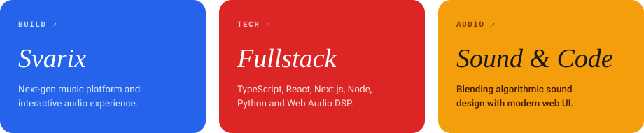
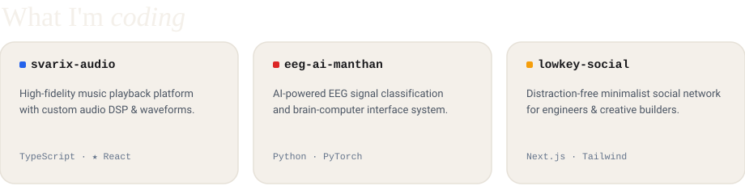

  

  

  

  

  

  <a href="https://github.com/aryannn555"><b>github</b></a> &nbsp;•&nbsp; 
  <a href="https://github.com/aryannn555/Svarix-New"><b>svarix music</b></a> &nbsp;•&nbsp; 
  <a href="https://linkedin.com"><b>linkedin</b></a> &nbsp;•&nbsp; 
  <a href="https://github.com/aryannn555?tab=repositories"><b>repositories</b></a>

Refreshed automatically every day via GitHub Actions ⚡

