<div align="center">

# ⚡ aryannn555

### Fullstack Engineer & Audio Dev · Creator of [Svarix](https://github.com/aryannn555/Svarix-New)

<p align="center">
  
  
  
</p>

</div>

---

### 💻 System Terminal

<div align="center">
  
  &nbsp;
  
</div>

<br/>

### 📊 Live Activity Calendar

<div align="center">
  
</div>

<br/>

---

### 🚀 Featured Project: `Svarix`

```bash
$ svarix --info
```

> **[Svarix](https://github.com/aryannn555/Svarix-New)** is a high-performance modern music and audio experience platform built with a modern stack, seamless audio playback, and responsive interactive interfaces.

- **Stack**: React, TypeScript, Node.js, Web Audio API, TailwindCSS
- **Repository**: [aryannn555/Svarix-New](https://github.com/aryannn555/Svarix-New)

---

### 🛠 Tech Stack & Tooling

```bash
$ cat ~/.config/skills.json
```

```json
{
  "languages": ["TypeScript", "JavaScript", "Python", "C++", "HTML/CSS"],
  "frontend": ["React", "Next.js", "TailwindCSS", "Radix UI", "Framer Motion"],
  "backend": ["Node.js", "Express", "REST APIs", "GraphQL"],
  "audio_multimedia": ["Web Audio API", "Tone.js", "Audio DSP"],
  "tools": ["Git", "Docker", "VS Code", "Neovim", "zsh", "tmux", "Figma"]
}
```

---

### 📬 Connect With Me

```bash
$ ./contact.sh
```

- 🌐 **GitHub**: [@aryannn555](https://github.com/aryannn555)
- 🎧 **Projects**: [Svarix Music Platform](https://github.com/aryannn555/Svarix-New)
- 💬 **Ask me about**: Fullstack web development, music technology, interactive UI design

<br/>

<div align="center">
  <sub>Generated with self-contained SVGs & auto-updated daily via GitHub Actions ⚡</sub>
</div>
